# Cat & coffee animation

An 8-second looping brand animation built from `cat vector .svg`:

1. **Leap**: the cat jumps in from the left (sparkles twinkle, its shadow follows along the ground).
2. **Sit**: it lands with a squash-and-bounce and sits holding a hot cup. The steam rises and the cat blinks.
3. **Drink**: it switches to sipping an iced coffee with a wink, and a heart floats up.
4. It crouches and leaps out to the right, so the loop runs on seamlessly.

| File | Use it for |
| --- | --- |
| `cat-coffee-animation.svg` | Websites. Transparent background, scales to any size, about 70 KB. Animated with CSS, so it plays in an `` tag. |
| `cat-coffee-animation.mp4` | Social posts, reels, presentations. 1920×1080, 30 fps, cream background. |
| `cat-coffee-animation.gif` | Email signatures, Notion, anywhere video isn't supported. 640 px wide. |

## Embed on a website

```html

```

Visitors who turn on "reduce motion" in their system settings see the still sitting pose instead.

Colours are the illustration's own: pink `#fccecd`, brown `#94521b`, white `#fdfdfd`. The video background is `#fff7f2`.
