# Mimi Coffee logo animation

Animated versions of `mimi.svg`. The sleepy cat opens its eyes, blinks, then raises a paw and waves.

## Two versions

**Intro** (`mimi-logo-intro.*`, 5.2 s, plays once)
The cat pops up asleep, the "Mimi Coffee" letters bounce in one by one, then the cat opens its eyes and waves. It stops on the waving pose, so it works as a website splash, video opener or end card.

**Loop** (`mimi-logo-animated.svg`, `mimi-logo-loop.*`, 6.4 s, repeats)
The full logo stays on screen. The cat breathes while it sleeps, opens its eyes, waves, lowers its paw and dozes off again. Good for a site header, social profile or email signature.

| File | Use it for |
| --- | --- |
| `mimi-logo-intro.svg` | Website intro or splash. Transparent background, any size. |
| `mimi-logo-animated.svg` | Website header or footer. Transparent background, loops. |
| `mimi-logo-intro.mp4` | Reels, stories, video openers. 1080×1080, white background. |
| `mimi-logo-loop.mp4` | Instagram or LinkedIn posts. 1080×1080, white background. |
| `mimi-logo-intro-transparent.webm` | Overlaying the logo on your own footage in a video editor. Transparent background. |
| `mimi-logo-loop.gif` | Email signatures, Notion, anywhere video doesn't play. |

## Embed on a website

```html

```

The SVGs animate with plain CSS, so they play inside a normal `` tag. Visitors who turn on "reduce motion" see a still logo with the cat's eyes open.

The artwork is the original `mimi.svg` and is unchanged. The cat's right front leg is lifted out to become the waving paw, and the open eyes are drawn in the same brown (`#8c4c18`).
