# Mimi Coffee animated stickers

Animated versions of the sticker sheet `mimi (1).svg`. Each sticker floats gently, and each cat does its own thing in a 6.4-second loop:

- **Coffee:** steam curls up from the cup, the cat blinks and breathes.
- **Leap:** the cat glides up and down in mid-air, the motion lines flicker and the sparkles twinkle.
- **Wave:** Mimi wakes up, waves, lowers the paw and dozes off again.

| File | Use it for |
| --- | --- |
| `mimi-stickers-animated.svg` | The full sheet on the blue background, for websites. Scales to any size. |
| `mimi-stickers-animated.mp4` | The full sheet as a 1920×960 video for social posts. |
| `mimi-stickers-animated.gif` | The full sheet, 900 px wide, for email, Notion and similar. |
| `mimi-sticker-coffee.svg` / `-leap.svg` / `-wave.svg` | Single stickers with a transparent background, for websites. |
| `mimi-sticker-coffee.webp` / `-leap.webp` / `-wave.webp` | Chat stickers: 512×512, transparent, animated, each under 500 KB. They fit WhatsApp's and Telegram's animated-sticker limits. |

In the WebP chat stickers the sticker itself stays still and only the cat moves. That keeps the files small enough for messaging apps.

## Embed on a website

```html

```

The SVGs animate with plain CSS, so they play inside a normal `` tag. Visitors who turn on "reduce motion" see still stickers.

## Notes on the artwork

- **Coffee and Wave cats:** rebuilt from the original vectors, `cat vector .svg` and `mimi.svg`. They're aligned to the sheet, so the still frame matches the original. The only change is that the cup's leaf is brown, to match the sticker.
- **Leap cat:** uses the sheet's own illustration, split into body, motion lines and sparkles so each part moves on its own.
- **Cream circles:** redrawn as vector circles with the same soft shadow, so the files stay small.
